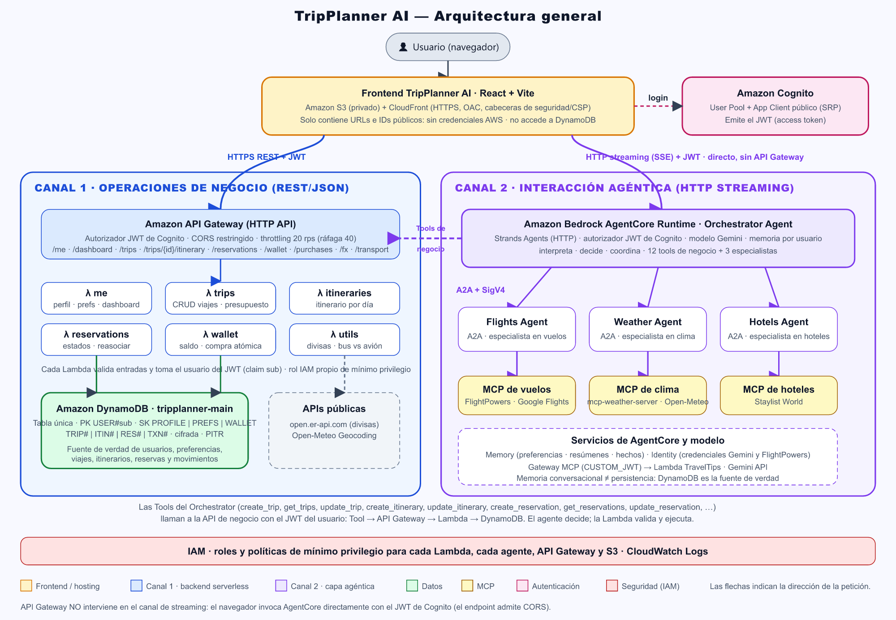

# TripPlanner AI — Documentación técnica

> Trabajo final · Programación Agéntica · Ingeniería de Sistemas
> Región AWS `us-east-2` · Cuenta `406868032460`
> Documentos hermanos: [Requisitos](sdd/requirements.md) · [Diseño](sdd/design.md) · [Plan de tareas](sdd/tasks.md) · [Evidencias](evidencias/README.md) · [Diseño visual (Stitch)](diseno-stitch/)

## Índice
1. [Resumen](#1-resumen)
2. [Arquitectura](#2-arquitectura)
3. [Modelo de datos](#3-modelo-de-datos)
4. [APIs](#4-apis)
5. [Lambdas](#5-lambdas)
6. [Tools del agente](#6-tools-del-agente)
7. [Integración de agentes](#7-integración-de-agentes)
8. [Seguridad](#8-seguridad)
9. [Frontend](#9-frontend)
10. [Pruebas](#10-pruebas)
11. [Instrucciones de ejecución](#11-instrucciones-de-ejecución)
12. [Guion de la demostración](#12-guion-de-la-demostración)
13. [Limitaciones conocidas](#13-limitaciones-conocidas)

---

## 1. Resumen

TripPlanner AI convierte una solución multiagente (Strands Agents sobre Amazon Bedrock AgentCore) en una **aplicación web completa**:
el usuario inicia sesión, conversa con un asistente por *streaming*, consulta vuelos, clima y hoteles que se muestran como
**tarjetas**, crea viajes e itinerarios, registra reservas simuladas (con un monedero simulado) y recupera todo al volver a entrar.
El asistente puede hacer lo mismo que los botones de la interfaz: crear/editar viajes, itinerarios y reservas por chat.

| Pieza | Tecnología |
|---|---|
| Agentes | Python 3.12 · Strands Agents · AgentCore Runtime · A2A · MCP · modelo Gemini |
| Backend | AWS SAM · API Gateway HTTP · 8 Lambdas (Python 3.12) · DynamoDB (tabla única) · Cognito |
| Frontend | React 18 + Vite · S3 + CloudFront |
| Seguridad | JWT de Cognito, IAM de mínimo privilegio, validación en Lambda, CORS restringido, CSP |

**Se conserva la arquitectura multiagente** (Orchestrator + Flights + Weather + Hotels). Ninguna lógica de agentes está en el frontend.

## 2. Arquitectura



*(Fuente editable: [arquitectura.svg](arquitectura.svg))*

### 2.1 Dos canales independientes

| | Canal 1 · Negocio | Canal 2 · Agéntico |
|---|---|---|
| Ruta | Frontend → API Gateway → Lambda → DynamoDB | Frontend → HTTP streaming → AgentCore → Orchestrator |
| Protocolo | REST/JSON sobre HTTPS | SSE (`text/event-stream`) sobre HTTPS |
| Autorización | Autorizador JWT de Cognito en API Gateway | `customJWTAuthorizer` de Cognito en el runtime |
| Uso | Listados, formularios, pantallas | Chat y búsquedas de vuelos/clima/hoteles |

API Gateway **no** interviene en el canal de streaming: el navegador invoca el endpoint de AgentCore directamente (que admite CORS) con
el JWT del usuario.

### 2.2 Componentes

| Componente | Responsabilidad |
|---|---|
| Frontend | Experiencia de usuario; sesión Cognito; consume ambos canales |
| Cognito | Registro/inicio de sesión; emite el JWT |
| API Gateway | Exposición REST, autorización, CORS, *throttling* |
| Lambda | Lógica de negocio y validaciones |
| DynamoDB | Persistencia (fuente de verdad) |
| AgentCore Runtime | Ejecución y exposición (streaming) de los agentes |
| Strands Agents | Coordinación y comportamiento agéntico |
| MCP | Herramientas especializadas de vuelos, clima y hoteles |
| AgentCore Memory | Contexto conversacional del agente (no sustituye la persistencia) |
| S3 + CloudFront | Publicación del frontend (HTTPS, OAC) |
| IAM | Seguridad de mínimo privilegio |

### 2.3 Decisiones de diseño principales
Ver [design.md §1 y §10](sdd/design.md). Las más relevantes:

* **D-02 — Las Tools de negocio llaman a la misma API que el frontend**, reenviando el JWT del usuario. Una sola implementación de
  validaciones y control de acceso; la identidad la fija el token, nunca el modelo.
* **D-04 — Tabla única** de DynamoDB (ver §3).
* **D-05 — Agent-Driven UI:** el Orchestrator emite eventos `ui` con datos estructurados además del texto.

## 3. Modelo de datos

Tabla única `tripplanner-main` (facturación bajo demanda, cifrado en reposo, recuperación a un punto en el tiempo). Claves: `PK` (partición) y `SK` (ordenación).

| Entidad | PK | SK | Atributos |
|---|---|---|---|
| Perfil | `USER#<sub>` | `PROFILE` | `email`, `name`, `createdAt` |
| Preferencias | `USER#<sub>` | `PREFS` | `defaultBudgetCOP`, `activities[]`, `airlines[]`, `restrictions`, `updatedAt` |
| Monedero | `USER#<sub>` | `WALLET` | `balanceCOP`, `updatedAt` |
| Movimiento | `USER#<sub>` | `TXN#<ISO-ts>#<id>` | `type` (`TOPUP`/`PURCHASE`/`REFUND`), `amountCOP`, `title`, `reservationId?`, `createdAt` |
| Viaje | `USER#<sub>` | `TRIP#<tripId>` | `name`, `origin`, `destination`, `startDate`, `endDate`, `travelers`, `budgetCOP`, `status`, `notes`, `createdAt`, `updatedAt` |
| Itinerario | `USER#<sub>` | `ITIN#<tripId>` | `tripId`, `days[]` → `{date, items[] → {time,title,place,costCOP,notes}}`, `updatedAt` |
| Reserva | `USER#<sub>` | `RES#<resId>` | `tripId`, `kind`, `title`, `priceCOP`, `details{}`, `status`, `paid`, `link?`, `originalPrice?`, `originalCurrency?`, `fxRate?`, `refunded?`, `createdAt`, `updatedAt` |

### Justificación
* **Aislamiento por construcción:** todo ítem cuelga de `USER#<sub>` y el `sub` sale del JWT verificado; ninguna consulta puede cruzar usuarios.
* **Sin `Scan`:** todos los patrones de acceso son `Query`/`GetItem`.
* **Reserva con `SK=RES#<id>` y `tripId` como atributo:** permite reasociarla a otro viaje con un `UpdateItem`.
* **Itinerario como un solo ítem:** se lee/reemplaza de forma atómica; el tamaño esperado queda muy por debajo de 400 KB.
* **Dinero como entero en COP:** evita errores de coma flotante.

### Patrones de acceso
| Patrón | Operación |
|---|---|
| Listar viajes | `Query PK=USER#u AND begins_with(SK,'TRIP#')` |
| Detalle de viaje | `GetItem TRIP#id` + `GetItem ITIN#id` + `Query RES#` filtrado por `tripId` |
| Listar reservas | `Query ... begins_with(SK,'RES#')` |
| Historial del monedero | `Query ... begins_with(SK,'TXN#')`, más reciente primero |
| Panel de inicio | `Query TRIP#` + `Query RES#` + `GetItem WALLET` |

### Estados de reserva
`SIMULADA` (por defecto) · `PENDIENTE` · `CONFIRMADA` (reservado a un proveedor real; el sistema no la produce) · `CANCELADA`.
Transiciones permitidas: `SIMULADA ↔ PENDIENTE`, y cualquiera de las dos → `CANCELADA`. La interfaz muestra una etiqueta visible por estado.

## 4. APIs

Base: `https://1uyl298pkh.execute-api.us-east-2.amazonaws.com`. Todas exigen `Authorization: Bearer <access token de Cognito>`.
Errores: `{"error": {"code": "...", "message": "...", "fields": {"campo": "motivo"}}}`.

| Método y ruta | Descripción | Respuestas |
|---|---|---|
| `GET /me`, `PUT /me` | Perfil (se crea en el primer acceso) / actualizar nombre y correo | 200, 400 |
| `GET /me/preferences`, `PUT /me/preferences` | Preferencias de viaje | 200, 400 |
| `GET /dashboard` | Próximos viajes, reservas recientes, saldo y totales | 200 |
| `POST /trips` | Crear viaje | 201, 400 |
| `GET /trips` | Listar viajes | 200 |
| `GET /trips/{id}` | Viaje + itinerario + reservas + resumen de presupuesto | 200, 404 |
| `PATCH /trips/{id}` | Actualizar campos del viaje | 200, 400, 404 |
| `DELETE /trips/{id}` | Eliminar viaje e itinerario (las reservas quedan sin viaje) | 200, 404 |
| `GET /trips/{id}/itinerary` | Consultar itinerario | 200, 404 |
| `POST /trips/{id}/itinerary` | Crear itinerario | 201, 400, 404, 409 (ya existe) |
| `PUT /trips/{id}/itinerary` | Reemplazar/modificar itinerario | 200, 400, 404 |
| `POST /reservations` | Registrar reserva sin cobro | 201, 400, 404 |
| `GET /reservations?tripId=&status=` | Listar/filtrar reservas | 200, 400 |
| `GET /reservations/{id}` | Detalle | 200, 404 |
| `PATCH /reservations/{id}` | Editar, cambiar estado, reasociar, cancelar (reembolsa si estaba pagada) | 200, 400, 404, 409 |
| `GET /wallet` | Saldo y últimos 30 movimientos | 200 |
| `POST /wallet/topup` | Recarga simulada (1.000 – 10.000.000 COP) | 201, 400, 409 (tope de saldo) |
| `POST /purchases` | Compra atómica: descuenta saldo + crea reserva + registra movimiento | 201, 400, 404, 409 |
| `GET /conversations` | Conversaciones del usuario guardadas en la **memoria del agente** (título, fecha, turnos) | 200, 503 |
| `GET /conversations/{id}` | Conversación completa reconstruida (mensajes, herramientas y tarjetas) | 200, 404 |
| `DELETE /conversations/{id}` | Elimina la conversación de la memoria | 200, 404 |
| `GET /fx?from=USD&to=COP&amount=` | Tasa de cambio actual | 200, 400, 502 |
| `GET /transport?origin=&destination=` | Bus vs. avión puerta a puerta | 200, 400, 404, 502 |

Códigos de error comunes: `401` sin/ con token inválido · `404` no existe **o es de otro usuario** (no revela su existencia) · `409` conflicto ·
`413` cuerpo > 64 KB · `429` *throttling* · `500` error genérico (el detalle solo queda en CloudWatch).

### Ejemplos
```http
POST /trips
{"origin":"Bogota","destination":"Cartagena","startDate":"2026-12-10","endDate":"2026-12-13","travelers":3,"budgetCOP":5000000}
→ 201 {"id":"5f071c174bd44990","name":"Viaje a Cartagena","status":"PLANEADO", ...}

POST /purchases
{"tripId":"5f071c...","kind":"FLIGHT","title":"BOG → CTG · LATAM","priceCOP":420000,"idempotencyKey":"compra-0001"}
→ 201 {"reservation":{"status":"SIMULADA","paid":true, ...},"balanceCOP":1580000}
→ (repetida) 409 {"error":{"code":"DUPLICATE","message":"Esta compra ya fue registrada; no se cobro de nuevo."}}
→ (sin saldo) 409 {"error":{"code":"INSUFFICIENT_FUNDS","message":"Saldo insuficiente: la compra cuesta 420.000 COP y tu saldo es 0 COP. ..."}}
```

### Validaciones (en Lambda)
| Campo | Regla |
|---|---|
| `name`, `title` | 1–120 / 1–160 caracteres |
| `origin`, `destination` | 2–80 caracteres |
| `startDate`, `endDate` | `AAAA-MM-DD` válidas; `endDate ≥ startDate`; viaje ≤ 90 días |
| `travelers` | entero 1–20 (se rechazan booleanos y decimales) |
| `budgetCOP`, `priceCOP` | entero 0 – 1.000.000.000 |
| `kind` | `FLIGHT` \| `HOTEL` \| `ACTIVITY` |
| `status` | enum + transición permitida; `CONFIRMADA` solo la fija un proveedor |
| itinerario | ≤ 31 días, ≤ 20 actividades/día, `HH:MM`, fechas dentro del viaje, sin días repetidos |
| `link` | URL `http(s)` ≤ 2000 caracteres |
| `details` | objeto acotado (profundidad, tamaño y tipos) |

## 5. Lambdas

Todas en Python 3.12 / arm64, código compartido en `backend/src/common.py` (respuestas, errores, validación, enrutador, transacciones).

| Lambda | Rutas | Permisos DynamoDB (solo sobre `tripplanner-main`) |
|---|---|---|
| `tripplanner-me` | `/me`, `/me/preferences`, `/dashboard` | `GetItem`, `PutItem`, `UpdateItem`, `Query` |
| `tripplanner-trips` | `/trips`, `/trips/{id}` | `GetItem`, `PutItem`, `UpdateItem`, `DeleteItem`, `Query` |
| `tripplanner-itineraries` | `/trips/{id}/itinerary` | `GetItem`, `PutItem` |
| `tripplanner-reservations` | `/reservations*` | `GetItem`, `PutItem`, `UpdateItem`, `Query` |
| `tripplanner-wallet` | `/wallet*`, `/purchases` | `GetItem`, `PutItem`, `UpdateItem`, `Query` |
| `tripplanner-utils` | `/fx`, `/transport` | ninguno |
| `tripplanner-conversations` | `/conversations*` | ninguno en DynamoDB; solo `bedrock-agentcore:ListSessions`, `ListEvents` y `DeleteEvent` sobre **la memoria** |
| `tripplanner-presignup` | trigger de Cognito | ninguno |

Notas de implementación:
* La **compra** usa `TransactWriteItems` con tres operaciones (actualizar saldo con condición `balance ≥ precio`, crear la reserva con
  `attribute_not_exists`, registrar el movimiento). El `resId` deriva de `idempotencyKey`, por lo que un reintento choca con la condición
  y responde `409 DUPLICATE` sin cobrar de nuevo.
* **Cancelar** una reserva pagada ejecuta otra transacción (`status <> CANCELADA`, `refunded` ausente) → un único reembolso.
* IAM no tiene una acción `TransactWriteItems`: las transacciones exigen los permisos `PutItem`/`UpdateItem` de cada operación.
* La identidad (`sub`) se toma de `requestContext.authorizer.jwt.claims.sub`; el cuerpo no puede cambiarla.

## 6. Tools del agente

El Orchestrator (`app/OrchestratorAgent/business_tools.py`) expone estas Tools. Cada una es una operación de negocio respaldada por Lambda
(Tool → API Gateway → Lambda → DynamoDB) y reenvía el JWT del usuario.

| Tool | Parámetros principales | Endpoint / Lambda |
|---|---|---|
| `create_trip` | origin, destination, start_date, end_date, travelers, budget_cop, name?, notes? | `POST /trips` → `trips` |
| `get_trips` | trip_id? | `GET /trips[/{id}]` → `trips` |
| `update_trip` | trip_id + campos | `PATCH /trips/{id}` → `trips` |
| `create_itinerary` | trip_id, days[] | `POST /trips/{id}/itinerary` → `itineraries` |
| `update_itinerary` | trip_id, days[] | `PUT /trips/{id}/itinerary` → `itineraries` |
| `create_reservation` | trip_id, kind, title, price_cop, pay, details?, link?, idempotency_key?, original_* | `POST /reservations` o `POST /purchases` → `reservations` / `wallet` |
| `get_reservations` | trip_id?, status? | `GET /reservations` → `reservations` |
| `update_reservation` | reservation_id, status?, trip_id?, title?, link? | `PATCH /reservations/{id}` → `reservations` |
| `get_wallet` / `top_up_wallet` | amount_cop | `GET /wallet`, `POST /wallet/topup` → `wallet` |
| `convert_currency` | amount, from_currency, to_currency | `GET /fx` → `utils` |
| `compare_transport` | origin, destination | `GET /transport` → `utils` |
| `ask_flights` / `ask_weather` / `ask_hotels` | request | A2A (SigV4) → agentes especialistas |

**Barandillas deterministas (en código, no solo en el prompt).** Un modelo de lenguaje no es fiable para acciones con dinero, así que se hacen cumplir en `app/OrchestratorAgent/ui.py`:

| Barandilla | Qué impide |
|---|---|
| `purchase_gate` | Cobrar sin confirmación: `create_reservation(pay=true)` solo cobra si en un turno **anterior** se presentó el resumen (la primera llamada devuelve `CONFIRMATION_REQUIRED` sin cobrar), el monto coincide y el mensaje actual del usuario es afirmativo (“sí”, “confirmo”…). Las sesiones no se mezclan y la confirmación se consume. |
| `topup_allowed` | Recargar el monedero si el usuario no lo pidió en su mensaje. |
| `known_link` | Guardar enlaces inventados: solo se aceptan URLs que realmente devolvió un especialista en esa sesión. |
| Identidad | El modelo nunca decide el usuario: el JWT viaja en la petición y la API toma el `sub` del token. |

Reglas de comportamiento (prompt del Orchestrator): hacer solo lo pedido; no crear ni modificar datos sin petición explícita; pedir confirmación
antes de cobrar (reforzado por las barandillas anteriores); no afirmar acciones que no se ejecutaron; repetir al usuario los errores reales de los especialistas; convertir divisas a COP;
comparar bus vs. avión en trayectos cortos; avisar si se supera el presupuesto.

## 7. Integración de agentes

### 7.1 Streaming desde el navegador
```
POST https://bedrock-agentcore.us-east-2.amazonaws.com/runtimes/<ARN codificado>/invocations?qualifier=DEFAULT
Authorization: Bearer <access token>
X-Amzn-Bedrock-AgentCore-Runtime-Session-Id: <uuid>   (36 caracteres; identifica la conversación)
{"prompt": "..."}
```
El runtime valida el JWT (`CUSTOM_JWT`: discovery URL del *user pool* + `allowedClients`) y reenvía `Authorization` al agente
(`requestHeaderAllowlist`). El agente decodifica el `sub` para usarlo como `actor_id` de la memoria.

### 7.2 Protocolo de eventos (SSE)
| Evento | Forma | UI |
|---|---|---|
| Texto | `{"event":{"contentBlockDelta":{"delta":{"text":"…"}}}}` | Se concatena en la burbuja |
| Herramienta | `{"event":{"contentBlockStart":{"start":{"toolUse":{"name":"ask_flights"}}}}}` | Indicador “Consultando vuelos…” |
| Componente | `{"ui":{"component":"flights","data":{…}}}` | Se renderiza una tarjeta |

### 7.3 Agent-Driven UI
Los especialistas terminan su respuesta con `<ui>{json}</ui>`; la Tool `ask_*` del Orchestrator lo **extrae**, lo publica como evento `ui` y
entrega al modelo solo el texto (el modelo no copia ni altera el JSON). Las Tools de negocio publican de forma análoga el resultado de la API.

| `component` | Origen | Componente visual |
|---|---|---|
| `flights` | Flights Agent | Tarjetas comparativas (marcas “más barato” / “más rápido”) |
| `weather` | Weather Agent | Tarjetas por día |
| `hotels` | Hotels Agent | Tarjetas con enlaces de reserva |
| `trip` / `trips` | Tools de viajes | Tarjetas de viaje con presupuesto |
| `itinerary` | Tools de itinerario | Agenda por día |
| `reservation(s)` | Tools de reservas | Lista con etiqueta de estado |
| `wallet`, `currency`, `transport` | Tools de monedero, divisas y transporte | Saldo, conversión, comparación |

### 7.4 MCP y A2A
* **Flights** → MCP remoto FlightPowers (Google Flights); la clave de RapidAPI se obtiene de **AgentCore Identity** (credencial `FlightPowers`).
* **Weather** → MCP `mcp-weather-server` (Open-Meteo) lanzado por stdio dentro del runtime.
* **Hotels** → MCP remoto Staylist World.
* El Orchestrator llama a los especialistas por **A2A** con SigV4 (`bedrock-agentcore:InvokeAgentRuntime` y `GetAgentCard` solo sobre `tripplanner_*`).
* **Memoria:** AgentCore Memory (preferencias, resúmenes, hechos) por usuario (`actor_id = sub`). No reemplaza a DynamoDB.
* **Historial de conversaciones en la memoria del agente:** el Strands session manager guarda cada mensaje (texto, llamadas a herramientas) en la memoria
  con `actor = sub` y `session = id de la conversación`. Al terminar cada turno el Orchestrator guarda además las **tarjetas** mostradas (vuelos, clima,
  hoteles, viajes…) como un evento en el actor hermano `ui-<sub>` de la **misma memoria** (así no interfiere con la restauración de Strands). La Lambda
  `conversations` lee ambos actores —siempre a partir del `sub` del JWT, por lo que nadie puede leer conversaciones ajenas— y reconstruye cada turno
  como `[herramientas, tarjetas, texto]`. El frontend lista las conversaciones, abre la que elijas y permite eliminarla; sobreviven a cerrar el navegador
  o cambiar de dispositivo (retención configurada en la memoria: 30 días).

## 8. Seguridad

| Control | Implementación |
|---|---|
| Autenticación | Cognito (SRP); JWT en ambos canales |
| Autorización por usuario | `sub` del token como clave de partición; 404 ante recursos ajenos |
| IAM mínimo privilegio | Un rol por Lambda con acciones concretas; el rol del Orchestrator **no** tiene acceso a DynamoDB |
| Sin credenciales en el navegador | Solo `VITE_API_URL`, `VITE_AGENT_URL`, `VITE_USER_POOL_ID`, `VITE_CLIENT_ID` (públicos) |
| Validación | En cada Lambda (tipos, rangos, fechas, estados, tamaños) |
| Protección de API | Autorizador JWT, CORS restringido a CloudFront y `localhost:5173`, *throttling* 20 rps / ráfaga 40 |
| Errores | Códigos HTTP correctos, mensajes claros, sin detalles internos |
| Hosting | Bucket S3 privado + OAC; cabeceras HSTS, CSP, X-Frame-Options, X-Content-Type-Options |
| Enlaces del modelo | El frontend solo abre URLs `http(s)` (`safeUrl`) con `rel="noopener noreferrer"`; Markdown sin HTML crudo |
| Pagos | **No** se solicitan ni almacenan datos de tarjeta; la recarga solo recibe un monto |

## 9. Frontend

React 18 + Vite, diseño basado en las pantallas de Stitch (móvil primero, barra inferior; barra lateral en escritorio) sobre **fondo blanco**.
Módulos: Inicio (dashboard) · Asistente IA · Vuelos · Clima · Hoteles · Mis viajes (lista, formulario, detalle con itinerario editable y presupuesto) ·
Reservas · Monedero · Preferencias. Las pantallas se recargan solas cuando el chat modifica datos (y viceversa).

## 10. Pruebas

| Nivel | Qué | Resultado |
|---|---|---|
| Unitarias backend (pytest + moto) | validaciones, aislamiento, estados, compra atómica, idempotencia, reembolso, divisas, bus/avión, barandillas del agente e historial de conversaciones | **48 pruebas** |
| Unitarias frontend (vitest) | parser SSE, `safeUrl`, duración | **6 pruebas** |
| Reales sobre la API desplegada | éxito, 400, 401, 404, 409, CORS, dos usuarios | [Evidencia 01](evidencias/01-api-backend.md) |
| Reales del escenario con agentes | 7 turnos por streaming con JWT | [Evidencia 02](evidencias/02-agentes-streaming.md) |
| Inventario de infraestructura | recursos reales en AWS | [Evidencia 03](evidencias/03-infraestructura.md) |

## 11. Instrucciones de ejecución

### 11.1 Requisitos
Python 3.12 + `uv`, Node 20+, AWS CLI v2, AWS SAM CLI (`uv tool install aws-sam-cli`), AgentCore CLI, credenciales de AWS (perfil), y las claves
de Gemini y FlightPowers (RapidAPI) en `agentcore/.env.local`.

```powershell
$env:AWS_PROFILE = "nueva"        # perfil de la cuenta 406868032460
$env:AWS_REGION  = "us-east-2"
```

### 11.2 Backend serverless (SAM)
```powershell
cd backend
sam build
sam deploy            # usa samconfig.toml; crea tabla, Cognito, API, Lambdas, S3 y CloudFront
```
Salidas: `ApiUrl`, `UserPoolId`, `UserPoolClientId`, `FrontendBucketName`, `FrontendUrl`, `DistributionId`.

### 11.3 Agentes (AgentCore)
Completa en `agentcore/agentcore.json` (runtime `OrchestratorAgent`) los valores de Cognito y la API:
`authorizerConfiguration.customJwtAuthorizer.discoveryUrl` = `<UserPoolIssuer>/.well-known/openid-configuration`, `allowedClients` = `[<UserPoolClientId>]`,
y la variable `API_URL` = `<ApiUrl>`.
```powershell
agentcore validate
agentcore deploy --yes
```

### 11.3b Frontend
```powershell
cd frontend
copy .env.example .env      # completa los 4 valores públicos
npm install
npm test
npm run build
aws s3 sync dist/ s3://<FrontendBucketName> --delete
aws cloudfront create-invalidation --distribution-id <DistributionId> --paths "/*"
```
Desarrollo local: `npm run dev` → http://localhost:5173 (ya permitido por CORS).

### 11.4 Pruebas
```powershell
cd backend ; uv venv .venv ; uv pip install -r requirements-dev.txt --python .venv\Scripts\python.exe
.venv\Scripts\python.exe -m pytest -q
.venv\Scripts\python.exe scripts\api_evidence.py   --api-url <ApiUrl> --client-id <ClientId> --origin <FrontendUrl>
.venv\Scripts\python.exe scripts\agent_evidence.py --api-url <ApiUrl> --agent-url <AgentUrl> --client-id <ClientId> --email <correo> --password <clave>
```

### 11.5 Eliminar todo (evitar costos)
```powershell
aws s3 rm s3://<FrontendBucketName> --recursive
sam delete --stack-name tripplanner-backend
agentcore remove all ; agentcore deploy --yes     # o eliminar el stack AgentCore-tripplanner-default
```

## 12. Guion de la demostración
1. Abrir la URL de CloudFront e **iniciar sesión** (o crear cuenta).
2. En **Asistente IA** escribir el escenario obligatorio (con fechas dentro de los próximos 16 días para ver el clima real).
3. Ver el **streaming** y los indicadores por agente; aparecen **tarjetas de clima y de hoteles** (y de vuelos si el servicio tiene cuota).
4. Pedir **“Crea el viaje”** → tarjeta de viaje; **“Genera y guarda el itinerario”** → agenda por día.
5. **Recargar** el monedero (botón o chat) y pedir **reservar** el hotel: el asistente pide confirmación; confirmar → reserva **Simulada** y saldo descontado.
6. Mostrar **DynamoDB** (consola) con los ítems del usuario.
7. **Cerrar sesión / cerrar la app**, volver a entrar y recuperar viajes, itinerario, reservas y saldo.

## 13. Limitaciones conocidas
* **Cuota de FlightPowers (RapidAPI):** el plan gratuito tiene cuota mensual; cuando se agota, el agente de vuelos lo informa y no inventa tarifas.
* **Auto-confirmación de registro:** el *trigger* PreSignUp evita depender del correo en la demo; en producción se exigiría verificación real.
* **Precios de compra simulada:** el precio lo aporta el agente (observado en el MCP); un sistema real lo revalidaría con el proveedor.
* **Datos de bus:** son estimaciones (no existe una API abierta de buses), y así se indica.
* **Reservas `CONFIRMADA`:** el estado existe en el modelo, pero no hay proveedor real integrado.
